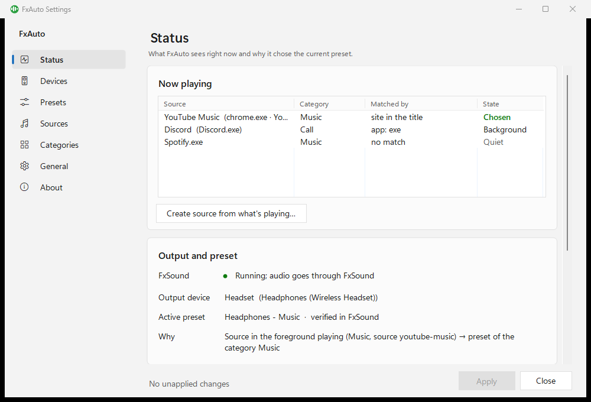
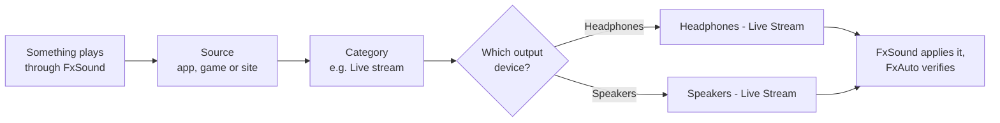
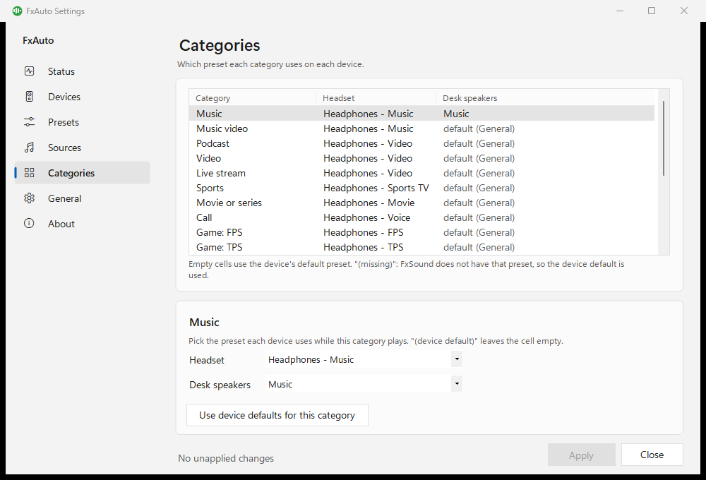
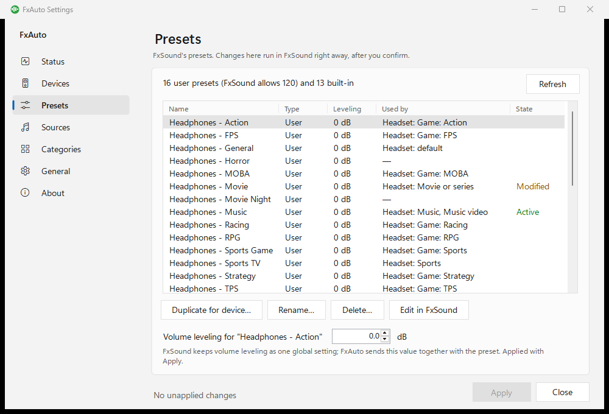
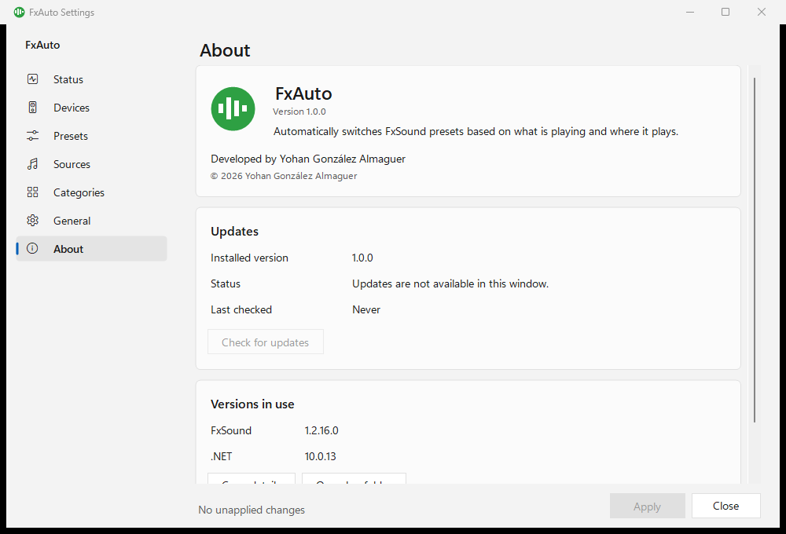

# FxAuto

**FxAuto switches [FxSound](https://www.fxsound.com/) presets for you, based on what is playing and on which
device it plays.** A game, a music app, a YouTube tab or a live stream each get the preset you picked for them, and
the same live stream can use one preset on your headphones and another on your speakers.

FxAuto is a small Windows tray app. It sends commands to the FxSound instance that is already running and checks
FxSound's own status file to confirm that each change took effect. It never kills or relaunches FxSound and never
steals the focus from the window you are using.



## Contents

- [Features](#features)
- [Requirements](#requirements)
- [Install, update and uninstall](#install-update-and-uninstall)
- [How FxAuto decides](#how-fxauto-decides)
- [Tray icon and menu](#tray-icon-and-menu)
- [Settings window](#settings-window)
- [Presets](#presets)
- [Configuration files](#configuration-files)
- [Privacy](#privacy)
- [Languages and themes](#languages-and-themes)
- [Troubleshooting and FAQ](#troubleshooting-and-faq)
- [Building from source](#building-from-source)
- [Project layout](#project-layout)
- [Releasing](#releasing)
- [Contributing](#contributing)
- [License](#license)
- [Disclaimer](#disclaimer)

## Features

- **Follows what is actually playing.** It listens to the Windows audio sessions that play through FxSound, so a
  paused or muted video does not count.
- **Recognises apps, games and websites.** Apps by their executable or Store app ID, games by their executable or
  by their install folder (any Steam game, for example), and websites by the browser tab title, including
  background tabs, without a browser extension.
- **Categories.** Every source plays as a category: Music, Music video, Podcast, Video, Live stream, Sports, Movie
  or series, Call, ten game genres (FPS, TPS, Action, RPG, Horror, Racing, Sports, Strategy, MOBA…), Unknown and
  Hold (no change). Many apps, sites and games are built in.
- **Per-device presets.** Each output device (headphones, speakers…) has its own preset for each category and a
  default preset, so switching devices switches presets too.
- **One clear winner.** When several things play at once, a fixed priority ladder decides (a foreground game beats
  background music, for example), with a minimum time on a preset so it does not flicker.
- **Preset management from FxAuto.** Duplicate a preset for another device, rename or delete presets (FxAuto updates
  every place that uses them), set volume leveling per preset, and edit a preset in FxSound with automatic changes
  paused until you finish.
- **Manual control from the tray.** Lock on a preset, pause for an hour or until restart, switch FxSound's output.
- **Explains itself.** The Status page shows what FxAuto sees, which source won and *why* it chose the current
  preset.
- **Safe with your config.** Settings are saved atomically with a backup; hand edits to `config.json` are reloaded
  automatically, and a broken file never replaces the last good configuration.
- **Automatic updates** from GitHub Releases, verified with SHA-256 before installing (can be turned off).
- **English and Spanish** interface, light and dark themes.
- **Lightweight and private.** No third-party packages, no admin rights, no telemetry, no code injected into other
  programs.

## Requirements

- Windows 10 or 11, 64-bit (x64).
- [FxSound](https://www.fxsound.com/) installed (the free app). FxAuto controls it; it does not replace it.
- Nothing else: the installer includes the .NET runtime.

## Install, update and uninstall

### Install

1. Download `FxAuto-Setup-<version>.exe` from the
   [latest release](https://github.com/ZahiriNatZuke/fxauto/releases/latest). Each release also has a
   `.sha256` file if you want to check the download.
2. Run it. It installs **for the current user only**, without administrator rights, into
   `%LOCALAPPDATA%\Programs\FxAuto`. FxAuto must not run elevated, or it could not control FxSound.
3. The wizard offers a desktop shortcut, **Start FxAuto with Windows** and launching FxAuto at the end. A Start menu
   shortcut is always created.

The installer is not code-signed yet, so Windows SmartScreen may show an *"Unknown publisher"* warning. Select
**More info → Run anyway**.

On first start FxAuto has no devices configured. When audio first plays on a device, it shows a notification
**"New output device: configure"**; click it (or open **Settings… → Devices**) to give the device a tag and a
default preset. Until then FxAuto leaves that device's preset alone.

### Update

- FxAuto checks GitHub Releases **once a day** (the first check a few minutes after it starts). When a newer
  version exists, it shows a tray notification once per version, and an **Update to x.y.z…** entry appears at the
  top of the tray menu.
- The update itself is always your choice: in **Settings → About**, select **Update now**. FxAuto downloads the
  installer, checks it against the release's SHA-256 fingerprint (a mismatch is deleted and nothing is installed),
  then runs it silently. FxAuto closes, the installer replaces the program in place, and FxAuto starts again.
  Your settings and the tasks chosen at install time are kept.
- You can also install a newer `FxAuto-Setup` by hand over the old version: a running FxAuto is closed first
  (`--exit`) and settings are kept.
- Turn automatic checks off, or opt in to pre-releases, in **Settings → General → Updates**.

For reference, the silent command the updater uses is:

```
FxAuto-Setup-<x.y.z>.exe /VERYSILENT /SUPPRESSMSGBOXES /NORESTART /RELAUNCH
```

### Uninstall

Use **Windows Settings → Apps → Installed apps → FxAuto → Uninstall**. It closes FxAuto, removes the
"Start with Windows" entry and asks whether to delete your settings (`%APPDATA%\FxAuto`) and logs
(`%LOCALAPPDATA%\FxAuto`). **They are kept by default**, so a later reinstall picks them up again. FxSound and its
presets are never touched.

## How FxAuto decides

### From sound to preset



1. **Something plays.** FxAuto watches the audio sessions on FxSound's virtual device. A program counts as playing
   after about 1.5 s of continuous sound and stops counting after 8 s of silence (20 s for games). These times are
   in **General → Timing**.
2. **Source.** FxAuto recognises who is playing: an app by its `.exe` (or Store app ID), a game by its `.exe` or
   its folder (for example any program under `\steamapps\common\`), a website by a segment of the browser tab
   title. A browser playing a site FxAuto does not know uses the browser's own category (Video by default).
3. **Category.** Each source has a category. For example, Twitch is *Live stream*, Spotify is *Music*, Netflix is
   *Movie or series*. Anything unrecognised is *Unknown*.
4. **Output device.** FxAuto looks at the real device the sound reaches: FxSound's selected output when FxSound is
   running and is the Windows default device, otherwise the Windows default output. Each managed device has a short
   tag, such as `Headphones` or `Speakers`.
5. **Preset.** The preset is chosen in this order:
   1. the source's own preset on that device, if you gave it one;
   2. otherwise the category's preset on that device (the **Categories** table);
   3. otherwise the device's default preset.

   A preset FxSound does not have is never sent: FxAuto falls back to the device default and shows a warning.
6. **Apply and verify.** FxAuto sends one command to FxSound (plus that preset's volume leveling) and checks
   FxSound's `status.json` until the preset is confirmed. The tray icon turns green when it is.

### When several things play at once

Only one source drives the preset. FxAuto walks down this ladder and the **first level with a candidate wins**:

| # | Level | Example |
| --- | --- | --- |
| 1 | **Locked**, **Paused** or **Editing** (your manual mode) | You locked on a preset from the tray |
| 2 | A **Hold** source is playing: changes are frozen | An app you put in *Hold (no change)* |
| 3 | **Game in the foreground** that is playing | The game window you are in |
| 4 | **Game in the foreground loading**: just started, still silent | The preset is ready before the game makes sound |
| 5 | **Other source in the foreground** that is playing | The browser tab you are watching |
| 6 | **Game in the background** that is playing | A minimized game beats background music |
| 7 | **Background source that started playing most recently** | Music started after a video |
| 8 | **Nothing playing**: keep the current preset for the grace time | A short pause does not change anything |
| 9 | **Device default preset**, once the grace time ends | |

Some extra rules:

- A normal change waits a minimum time since the previous one (**General → Timing → Keep a preset at least**,
  5 s by default) so the preset does not jump back and forth. A foreground game does not wait.
- A new *Unknown* source in the background (an autoplaying ad, for example) does not take over from a recognised
  background source.
- Calls (*Call* category) are ignored by default and never win. In **General → Calls** you can choose
  **Use the Call category's preset during calls** instead.

### When FxAuto deliberately changes nothing

| Situation | What FxAuto does | What you see |
| --- | --- | --- |
| Unknown output device | Keeps the current preset and offers once to configure it | Notification *"New output device: configure"*; Status → Why says *unknown output device* |
| FxSound is closed | Does not start it, unless you turn on **Start FxSound if it is closed** in General | Red icon; **Start FxSound** appears in the tray menu |
| FxSound runs as administrator | Sends nothing, so as not to open a second FxSound | Notification *"FxSound is elevated"* |
| FxSound is running but the audio does not go through it | Sends no preset (it would have no effect) | *"FxSound is not processing the audio"* |
| Headset in hands-free (call) mode | No change while it lasts | Why: *hands-free (call) mode: no change* |
| A preset is missing in FxSound | Uses the device default, or no change if that is missing too | Warning *"Presets FxSound does not have"* |
| You are editing a preset in FxSound | Automatic changes pause until you Save or Discard | Grey icon, mode *Editing* |
| A device is disabled or has no default preset | No change on that device | Status → Why explains it |

## Tray icon and menu

The icon colour shows the state at a glance. Hover over it for the mode, the preset, the device and the reason;
double-click it to open **Settings** on the Status page.

| Icon | State | Meaning |
| --- | --- | --- |
| Green | Verified | The expected preset is set and confirmed in FxSound |
| Amber | Pending | A preset is being applied, or there is nothing to apply (unknown device, audio not going through FxSound) |
| Blue | Locked | Locked on one preset |
| Grey | Paused | Paused, or a preset is being edited |
| Red | Failed | FxSound is not running, or the last change failed |

Right-click menu, from top to bottom:

| Entry | What it does |
| --- | --- |
| *(status line)* | Read-only summary: mode, preset, device and reason |
| **Update to x.y.z…** | Only when an update is available. Opens Settings → About |
| **Auto** | Normal mode: the preset follows what is playing. Use it to end a lock or a pause |
| **Lock on current preset** | Keeps the preset that is set now |
| **Lock on ▸** | Locks on a preset you pick: your presets, plus a **Built-in ▸** submenu with FxSound's factory presets |
| **Pause ▸ 1 hour** | FxAuto sends nothing to FxSound for an hour, then returns to Auto |
| **Pause ▸ Until restart** | Pauses until FxAuto restarts |
| **Output ▸** | Switches FxSound's output among the devices FxSound lists; the preset follows the new device |
| **Create source from what's playing** | Opens Settings → Sources with the *Detect what is playing now* dialog |
| **Settings…** | Opens the settings window on the Status page |
| **Start FxSound** | Only shown when FxSound is closed. Starts it on request |
| **Open log** | Opens today's log in Notepad (or the log folder if there is no log yet) |
| **Exit** | Closes FxAuto. FxSound keeps running with its current preset |

A lock is remembered after a restart as long as the preset still exists, and so is **Pause ▸ 1 hour** while the
hour has not ended. **Until restart** is not remembered. While you edit a preset, Auto, Lock and Pause are disabled.

## Settings window

Open it from **Settings…** in the tray menu. The left side lists the pages; the footer shows whether there are
unapplied changes. Most changes are made on a working copy and saved with **Apply** (Ctrl+S); **Close** or
**Cancel** discards them (Esc). Operations on FxSound's presets (duplicate, rename, delete, edit) are the exception:
they run in FxSound right away, after you confirm. If `config.json` changes on disk while the window is open,
FxAuto merges or flags the difference instead of overwriting it.

### Status

*What FxAuto sees right now and why it chose the current preset.*

- **Now playing**: one row per source playing, with its **Category**, how it was **Matched by** (exe, folder, site
  in the title…) and its **State**: *Chosen*, *Foreground*, *Background* or *Quiet*.
- **Create source from what's playing…**: start a new source from a row (see [Sources](#sources)).
- **Output and preset**: FxSound's state (running, audio through FxSound or not, elevated), the **Output device**,
  the **Active preset** (*verified in FxSound* or *not verified yet*) and **Why**, the full reason chain, for
  example *"YouTube Music is playing in the foreground. Headphones → Music → Headphones - Music (category)."*
- **Mode**: **Automatic**, **Paused** or **Locked on** with a **Preset to lock on**, plus **Pause for 1 hour**.
- **Problems**: errors, warnings and notes, each with a **Fix** button that jumps to the right page. Errors must be
  fixed before you can apply.

### Sources

*Apps, games and sites FxAuto recognises, and the category each one plays as.*

- **Search sources** and **Show kind** (All kinds, Apps, Games, Sites, Browsers) filter the list. The **Notes**
  column marks *built in*, *fallback* and *own preset*.
- **Add app…**, **Add game…**, **Add site…** and **Edit…** open the source editor:
  - **Name** and **Kind**.
  - **Programs** (executable names, e.g. `spotify.exe`), **App ID** (Store app ID, optional) and **Folders** (any
    program inside them, e.g. `\steamapps\common\`), for apps and games.
  - **Site**: the site name as it appears in the browser tab title, e.g. `YouTube Music`.
  - **Title pattern** (advanced): a regular expression matched against the tab or window title.
  - **Category**, and **Only when no more specific source matches (fallback)**.
  - **Preset for this source** on each device, or *(use the category's preset)*.
- **Delete** removes a source and its own presets per device.
- **Detect what is playing now…** lists what is playing; pick one and the editor opens pre-filled. The proposal may
  contain a window title, so check the name and match fields before saving.
- **Ignored apps…**: programs FxAuto never treats as a source (FxSound itself, overlays, shell hosts…).
- **Launchers…**: game launchers (Steam, Epic, Battle.net…). Their child processes are checked as games; the
  launcher itself is not a game.
- **Game folder exclusions…**: folders and programs inside game folders that are not games (redistributables,
  crash handlers).

### Categories

*Which preset each category uses on each device.*



A table with one row per category and one column per managed device. Select a row to pick the preset each device
uses while that category plays. *(device default)* leaves the cell empty, and empty cells use the device's default
preset. **Use device defaults for this category** clears the whole row. *(missing)* means FxSound does not have that
preset, so the device default is used. *Hold (no change)* never changes the preset.

### Devices

*Outputs reported by Windows. FxSound's own virtual device is hidden.*

- The list shows each output's **Name**, **Tag**, **Default preset**, **Adapter** and **State** (*Current output*,
  *Connected*, *Disconnected*, *Not managed*). **Show disconnected devices** includes the ones not plugged in.
- **Manage this device** puts an output under FxAuto's control. A device FxAuto does not manage keeps whatever
  preset FxSound has.
- **Tag**: a short name used in preset names, e.g. `Headphones` in `Headphones - Music` (1–20 ASCII letters,
  digits, spaces, `_ . -`).
- **Default preset**: used when no category or source has its own preset on this device.
- **Recognised by**: how FxAuto recognises the device (adapter, output name, endpoints it has learned).
- **Forget device…**: FxAuto stops managing the device and removes its preset assignments. FxSound's presets are not
  touched.

### Presets

*FxSound's presets. Changes here run in FxSound right away, after you confirm.*



- The list shows **Name**, **Type** (*User* or *Built-in*), **State** (*Active*, *Modified*, *Missing in FxSound*),
  **Leveling** and **Used by** (which devices and categories use it). The summary shows how many user presets exist
  out of the maximum FxSound allows.
- **Refresh** re-reads the preset list from FxSound.
- **Duplicate for device…** creates an exact copy in FxSound under a new name, proposed as
  `<device tag> - <category>`, and can assign it right away (**Use it on this device for this category**).
- **Rename…** renames a user preset in FxSound and everywhere FxAuto uses it. Built-in presets cannot be renamed.
- **Delete…** deletes a user preset from FxSound (it cannot be undone). If it is a device's default, you pick a
  replacement first; other places that used it fall back to the device default.
- **Edit in FxSound** switches FxSound to the preset and pauses automatic changes. Tweak the sound in FxSound, then
  choose **Save**, **Save as new…** or **Discard** in the bar at the top of the settings window.
- **Volume leveling**: FxSound keeps volume leveling as one global setting, so FxAuto stores a value per preset and
  sends it together with the preset. Applied with **Apply**.

### General

*Language, startup, log and timing.*

- **Language and appearance**: **Language** (System default, English, Español) and **Theme** (System default, Light,
  Dark). The window reopens with the new choice when you apply.
- **Startup**: **Start FxAuto with Windows**; **Start FxSound if it is closed** (off by default, see
  [Troubleshooting](#fxsound-is-closed-or-has-no-sound-after-fxauto-starts-it)); **Wait after Windows starts**
  (only used when FxAuto is started with Windows and may start FxSound); **Check FxSound every**; **FxSound
  location** (empty = default install path; **Browse…** to pick `FxSound.exe`).
- **Programs**: **Read browser tabs to tell which site is playing** (on by default; uses Windows UI Automation,
  read-only. If reading tabs gets too slow FxAuto turns it off until it restarts).
- **Timing**: **Starts counting as playing after**, **Stops counting as playing after**, **Games stop counting
  after**, **A game may load silently for**, **Keep a preset at least** and **Back to the device default after**.
- **Calls**: **Ignore calls: never change the preset for a call** (default) or **Use the Call category's preset
  during calls**.
- **Log and privacy**: **Log detail** (Normal or Detailed (debug)) and **Write window and tab titles to the log**
  (off by default).
- **Updates**: **Check for updates automatically** (once a day, on GitHub Releases) and **Include pre-releases**
  (test versions; off by default).

### About



- Version, developer and the notice that FxAuto is not affiliated with FxSound.
- **Updates**: installed version, status and last check, with **Check for updates**. When an update is available:
  **Update now**, **Later**, **Release page** and the **Release notes**; a progress bar and **Cancel** while it
  downloads.
- **Versions in use**: FxSound and .NET versions, **Copy details** (for bug reports) and **Open log folder**.

## Presets

### Naming convention

FxAuto works with any preset name, but per-device presets are easiest to manage as **`<Device> - <Category>`**,
for example `Headphones - Music`, `Headphones - FPS` or `Speakers - Movie`. **Duplicate for device…** proposes
names in this form from the device **Tag** and the category.

FxSound's rules apply to names: up to 64 characters, ASCII letters, digits, spaces and `- _ . ( ) + & # , '`, no
leading or trailing space, dot or quote, and no two presets with the same name ignoring case. FxSound also has a
maximum number of user presets, shown on the Presets page.

### Presets per device

A typical setup:

1. **Devices**: manage each output and give it a tag and a default preset (for example `Headphones - General`).
2. **Presets → Duplicate for device…**: copy a good starting preset once per category you care about
   (`Headphones - Music`, `Headphones - Video`, `Headphones - FPS`…), and tick
   **Use it on this device for this category**.
3. **Presets → Edit in FxSound**: tune each copy in FxSound, then **Save**.
4. **Categories**: check the table; empty cells fall back to the device default.
5. For a single app or game that needs something special, give that **source** its own preset on the device.

When you add a second device (say, speakers), duplicate the headphone presets with the speakers' tag and adjust
them for the speakers.

### Tuned presets: the philosophy

The preset sets developed alongside FxAuto (for a Logitech G435 headset and Edifier R12U desktop speakers) follow
one idea: **a preset = device correction + category adjustment.**

- **Device correction** is the same base for every preset of a device and compensates for its frequency response.
  The headset needs some sub-bass back and a few narrow peaks and dips smoothed; the small speakers cannot
  reproduce deep bass at all, so instead of boosting it (which only causes distortion) the bass is cut low and the
  sense of bass is placed higher, and Bass Boost stays off.
- **Category adjustment** goes on top: neutral for Music, intelligibility for Video and Voice, level control for
  Live stream, body and dynamics for Movie, footstep clarity and little or no 3D Surround for competitive FPS,
  impact for Action, detail for Horror, and so on.

A summary of the research behind these presets, with the per-category settings for both devices, the `.fac`
preset file format and the sources, is in [docs/presets.md](docs/presets.md). The values are a starting point for
your own devices, not values to copy blindly.

## Configuration files

All files are UTF-8 JSON, written atomically (temporary file, then replace).

| File | Contents |
| --- | --- |
| `%APPDATA%\FxAuto\config.json` | Your configuration. Created with the defaults on first start |
| `%APPDATA%\FxAuto\config.json.bak` | The previous valid configuration, kept on every save |
| `%APPDATA%\FxAuto\config.json.invalid` | A broken `config.json` FxAuto moved aside when you chose to replace it |
| `%APPDATA%\FxAuto\runtime-state.json` | Runtime state, not settings (see below) |
| `%APPDATA%\FxAuto\update-state.json` | Update checker state: last check, latest known version, last version announced |
| `%LOCALAPPDATA%\FxAuto\fxauto-YYYY-MM-DD.jsonl` | Daily log, kept for 7 days |
| `%LOCALAPPDATA%\FxAuto\updates\` | Downloaded installers |

### config.json

You can edit it from the settings window or by hand: hand edits are reloaded automatically. If the file has errors,
FxAuto keeps using the previous valid configuration and lists the problems on the Status page; it does not
overwrite your file until you fix it or confirm **Replace config.json with these settings…**. A file written by a
newer FxAuto is used read-only.

Main keys (`schemaVersion` is 2):

| Key | What it holds |
| --- | --- |
| `general` | Settings from the General page: `language`, `theme`, `startWithWindows`, `startFxSoundIfClosed`, `fxSoundPath`, `logLevel`, `logTitles`, `readBrowserTabs`, `callPolicy`, `unknownDevice`, the timings (`startupGraceSeconds`, `checkIntervalSeconds`, `idleGraceSeconds`, `minDwellMs`, `gameLoadingMaxMs`, `detection` with `attackMs`, `releaseMs`, `gameReleaseMs`…) and `updates` (`checkAutomatically`, `includePrereleases`) |
| `presets` | Per-preset metadata FxAuto keeps: `volumeLeveling` and an optional `note` |
| `devices` | Managed devices: `id`, `displayName`, `tag`, `defaultPreset`, `enabled` and `match` (how the device is recognised) |
| `sources` | Apps, games, sites and browsers: `id`, `name`, `kind`, `category`, `fallback`, `origin` and `match` (`exe`, `aumid`, `folder`, `site`, `titleRegex`) |
| `assignments` | Presets per `device` and `category`, or per `device` and `source` |
| `ignoredApps`, `launchers`, `gameFolderExclusions` | The three lists from the Sources page |

Categories, config keys and preset names are always in English, whatever the interface language.

### runtime-state.json

Things FxAuto learns while running, kept apart from your settings: the Windows endpoints matched to each device,
the unknown devices it has already notified you about, a preset edit that was not finished, and the mode to restore
after a restart (a lock, or a pause for 1 hour that has not ended). If it is damaged, FxAuto starts with an empty
state and shows a warning.

### Logs

One JSON object per line (JSONL), one file per day, in English, kept for 7 days. Use **Open log** in the tray menu
or **Open log folder** on the About page. Reasons in the log name the category and the configured source, never a
window or tab title, unless you turn on **Write window and tab titles to the log** in General.

### Command line

| Option | Effect |
| --- | --- |
| `FxAuto.exe --exit` | Closes the running FxAuto in an orderly way (used by the installer) |
| `FxAuto.exe --autostart` | How Windows starts FxAuto at sign-in (the "Start with Windows" entry). Enables the startup wait before FxAuto may start FxSound |

Only one FxAuto runs per user session.

## Privacy

What FxAuto reads, all locally:

- **Windows audio sessions**: which processes are playing sound and how loud, to know what is playing.
- **The foreground window**: which program it belongs to, to tell foreground from background.
- **Browser tab titles**, through Windows UI Automation (read-only), only to recognise the site that is playing.
  Titles are used to classify and then dropped: they are not saved in the configuration or the runtime state, and
  are not written to the log unless you turn that on. You can turn tab reading off in General.
- **FxSound's own files** (`status.json` and its preset files) to verify changes and manage presets.

What FxAuto contacts on the network:

- **Only GitHub**, for updates: `api.github.com` (the repository's releases) and the release downloads on
  `github.com`. No account, no token, no telemetry; nothing about you or your PC is sent beyond a standard
  `User-Agent: FxAuto/<version>` header.
- Turn off **Check for updates automatically** in General and FxAuto makes no network request unless you select
  **Check for updates** on the About page.

FxAuto does not inject code into other programs and needs no administrator rights.

## Languages and themes

- **Language**: English or Spanish (Español). *System default* follows the Windows display language. Set it in
  **General → Language and appearance**; the tray menu changes at once, the settings window reopens when you apply.
  The installer is also available in English and Spanish.
- **Theme**: Light or Dark for the settings window; *System default* follows the Windows app mode.
- The log, `config.json` keys, category names stored in the config and preset names stay in English.

## Troubleshooting and FAQ

**Where do I start?** Open **Settings → Status**. *Why* says what FxAuto decided and the reason; *Problems* lists
anything blocking it, with a **Fix** button. For history, use **Open log** from the tray.

#### FxSound is closed or has no sound after FxAuto starts it

FxAuto does not start FxSound unless you turn on **Start FxSound if it is closed**. The safest choice is to turn on
**Launch on startup** in FxSound itself. Some security software (for example **Kaspersky**) blocks FxSound's audio
when another program starts it, so if you hear nothing after FxAuto started FxSound, let FxSound start itself and
turn the FxAuto option off.

#### "FxSound is elevated"

FxSound is running as administrator and FxAuto is not, so FxAuto sends it no commands (it would open a second
FxSound). Close FxSound and start it normally, without "Run as administrator".

#### "New output device: configure" / the preset never changes on a device

The device is not managed yet, so FxAuto keeps the current preset. Click the notification or open **Devices**,
select the device, choose **Manage this device**, give it a tag and a default preset, then **Apply**.

#### An app or site is detected wrong, or as Unknown

Play it, then use **Create source from what's playing** in the tray menu (or **Detect what is playing now…** on
Sources). Pick the row, check the name and the match fields, choose the category and save. For a website, the
**Site** field must match the site name as it appears in the tab title. If a launcher or helper program is taken
for a game, add it to **Launchers…** or **Game folder exclusions…**.

#### The preset does not change

Check, in order:

1. The tray icon colour and the **Mode** on Status: Locked, Paused or Editing stop automatic changes.
2. Whether the source is *Chosen* in **Now playing**. A foreground or newer source may be winning, a *Hold* source
   freezes changes, and calls are ignored by default.
3. **Keep a preset at least** and **Back to the device default after**: a change may simply be waiting.
4. Whether the audio really goes through FxSound (Status → FxSound), and whether the device is managed.
5. The **Categories** table and the **Problems** list: a missing preset falls back to the device default.

#### "FxSound is not responding"

An antivirus or a Windows prompt may be waiting for an answer. FxAuto backs off and retries; it never kills or
restarts FxSound.

#### Does FxAuto change my FxSound presets?

Only when you ask for it on the Presets page (duplicate, rename, delete, edit), always after a confirmation. Normal
operation only selects presets.

## Building from source

**Requirements:** Windows 10/11 x64, the [.NET 10 SDK](https://dotnet.microsoft.com/download), and for the
installer, [Inno Setup 6](https://jrsoftware.org/isinfo.php)
(`winget install --id JRSoftware.InnoSetup -e --scope user`). FxSound is needed to run the app, not to build it.

```powershell
# Build everything (CI uses -warnaserror)
dotnet build FxAuto.sln -c Release

# Run the tests: a small console test runner of its own (no test framework)
dotnet run --project tests/FxAuto.Tests -c Release

# Publish the app to a folder
dotnet publish src/FxAuto -c Release -o dist
```

**Settings preview.** `tools/settings-preview` opens the settings window with sample data, without FxSound or the
tray, and saves a screenshot of each page. Useful for UI work:

```powershell
dotnet run --project tools/settings-preview -- --theme dark --lang en --out preview --interactive
```

Options: `--theme dark|light`, `--lang en|es`, `--out <dir>`, `--interactive` (keep the window open),
`--updates` (update states of the About page), `--mem`.

**Installer.**

```powershell
pwsh installer/build.ps1                  # publish self-contained (win-x64) + compile the installer
pwsh installer/build.ps1 -SkipPublish     # recompile from the existing staging folder
pwsh installer/build.ps1 -Version 1.2.3   # set the installer version explicitly
```

It publishes FxAuto self-contained into `installer/staging/` and writes
`installer/Output/FxAuto-Setup-<version>.exe`.

## Project layout

| Path | Contents |
| --- | --- |
| `src/FxAuto.Core` | Platform-independent logic: configuration and validation, source classification, the priority arbiter, device matching, preset resolution and operations, FxSound command building and `status.json` parsing, update decisions, localization catalogs. No Windows APIs |
| `src/FxAuto` | The Windows app: audio sessions, foreground window and browser tabs (UI Automation), device monitoring, the FxSound port, tray icon, settings window, JSONL log, auto-start, update service |
| `tests/FxAuto.Tests` | Unit tests with their own console runner, plus fixtures (FxSound status and preset files) |
| `tools/settings-preview` | Settings window with sample data, for screenshots and UI work |
| `tools/integration` | Integration checks against a real FxSound (developer machine; never starts FxSound) |
| `tools/preset-sets` | One-off tool that built and tuned the per-device preset sets, one verified operation at a time |
| `tools/make-icon` | Generates the app icon (`app.ico`) |
| `tools/probe-devices`, `tools/probe-sessions`, `tools/spike` | Developer probes and early experiments |
| `installer/` | Inno Setup script (`FxAuto.iss`) and `build.ps1` |
| `.github/workflows/` | `ci.yml` (build and tests) and `release.yml` (tagged releases) |
| `docs/RELEASING.md` | How to publish a release |
| `docs/presets.md` | The tuned preset sets: philosophy, example values, the `.fac` file format and sources |
| `docs/images/` | Screenshots used in this README |

## Releasing

Releases are built by GitHub Actions when a `vX.Y.Z` tag is pushed: bump `<Version>` in `src/FxAuto/FxAuto.csproj`,
tag, push. The workflow builds with warnings as errors, runs the tests, builds the installer, writes its
`.sha256` file and creates the GitHub Release with both assets. Tags with a suffix (`v1.2.0-beta.1`) become
pre-releases, which the in-app updater only offers to users who opted in. Full steps:
[docs/RELEASING.md](docs/RELEASING.md).

## Contributing

For now, **issues and suggestions are welcome**: bug reports, apps, sites or games FxAuto should recognise, and
ideas. Please open an [issue](https://github.com/ZahiriNatZuke/fxauto/issues). When reporting a bug, include the
details from **About → Copy details** and, if you can, the relevant lines of the log (check them first: with
**Write window and tab titles to the log** on, they may contain titles).

## License

No license is granted. Copyright © 2026 Yohan González Almaguer. All rights reserved. The source is published for
transparency; you may view it and use the released app, but not redistribute or modify the code without permission.

## Disclaimer

FxAuto is an independent tool and is **not affiliated with, endorsed by or supported by FxSound**. FxSound is a
trademark of its owner. FxAuto only uses FxSound's public command-line interface and its own files on your PC.
